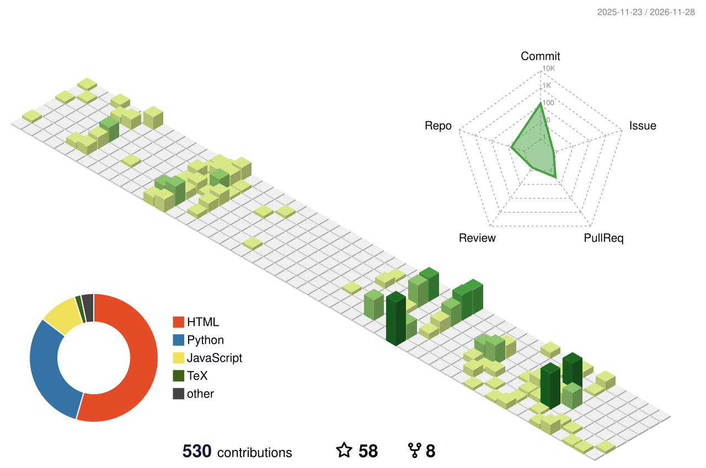

# Hi, I'm Minglai Yang 👋

**Research Scientist, Agents @ [Scale AI](https://scale.com/)** · San Francisco, CA

[Website](https://ymingl.com/) · [Google Scholar](https://scholar.google.com/citations?user=EV2fwFUAAAAJ) · [LinkedIn](https://www.linkedin.com/in/minglaiy) · [X](https://twitter.com/YMinglai) · [CV](https://ymingl.com/assets/pdf/cv.pdf) · [Email](mailto:minglai.yang@scale.com)

I build language models that humans can understand and trust. At Scale AI I work on agents and RL environments ([AgentEnv](https://github.com/scaleapi/agentenv-framework)), with a focus on reward design for RL post-training. Before that I was a Senior Member of Technical Staff at [Abaka AI](https://www.abaka.ai/), and I earned my B.S. in Computer Science from the [University of Arizona](https://cs.arizona.edu/) (4.0 GPA, summa cum laude, in just over two years).

Two questions drive my research:

- 🔍 **Deconstruction** — how do we open the black box and reveal the mechanisms inside LLMs?
- 🛠️ **Reconstruction** — how do we turn that insight into models that are robust, explainable, and useful in practice?

## Selected work

| Project | What it is | Links |
| --- | --- | --- |
| **Rubric Dropout** (2026) | A one-line fix for reward hacking in rubric-as-reward RL: drop a random subset of rubric criteria at every training step. | [paper](https://arxiv.org/abs/2608.11669) |
| **From Copying to Composition** (2026) | A controlled study, across 17 models, of how language models develop in-context learning. | [paper](https://arxiv.org/abs/2610.19113) |
| **AlignSAE** (TMLR 2026) | Sparse autoencoders whose features are aligned to human-defined concepts, enabling causal "concept swaps". | [paper](https://arxiv.org/abs/2512.02004) · [code](https://github.com/yminglai/AlignSAE) · [site](https://ymingl.com/alignsae-site/) |
| **Dr. DocBench** (2026) | An expert-level benchmark for difficult document parsing; official challenge track at DocInsights @ EMNLP 2026. | [paper](https://arxiv.org/abs/2606.01393) · [challenge](https://docinsights-workshop.github.io/docinsights-2026/) |
| **GSM-DC** (EMNLP 2025, Oral) | A controlled benchmark showing how irrelevant context distracts LLM reasoning, and how to train against it. | [paper](https://arxiv.org/abs/2505.18761) · [code](https://github.com/yminglai/GSM-DC) · [site](https://ymingl.com/GSMDC/) |
| **CopySpec** (EMNLP 2025, Oral) | Speculative copy-and-paste decoding, up to 3.08× faster generation with no quality loss. | [paper](https://arxiv.org/abs/2502.08923) · [code](https://github.com/razvandu/copyspec) |
| **EchoRL** (ICML 2026) | Reviving advantage-degenerated prompts in RLVR post-training via rollout echoing. | [paper](https://arxiv.org/abs/2605.31228) |

The full list is on my [publications page](https://ymingl.com/publications/).

## Side projects

- 🎮 [**Iron Vesper**](https://ymingl.com/iron-vesper/) — an original 3D real-time strategy game that runs in the browser.
- 🎓 [**AI Club at the University of Arizona**](https://uaaiclub.com/) — founded and led the club; raised $14K+ for student AI research and education.

## Get in touch

I'm happy to chat about agents, RL environments, interpretability, or research careers. Email me at [minglai.yang@scale.com](mailto:minglai.yang@scale.com).

